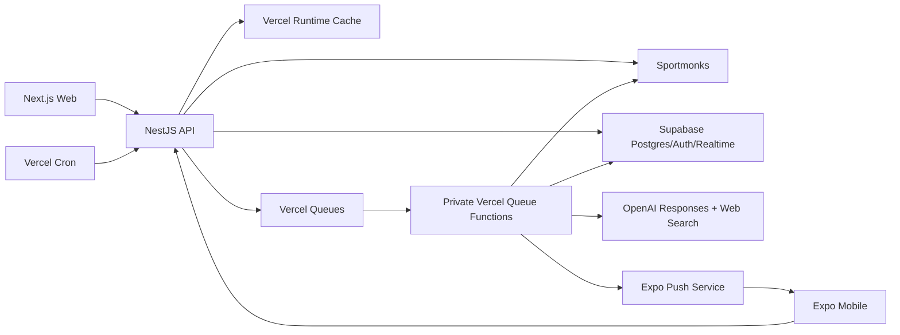

> API-Football cutover: the current identity, catalog and ingestion design is documented in [data ownership](data-ownership.md) and [the cutover runbook](../runbooks/api-football-cutover.md). Legacy gateway/cache descriptions below are historical.

# System architecture

The detailed provider/read-model boundary is documented in
[Football data ownership](./data-ownership.md).

## Trust boundaries

- Mobile and web receive only publishable Supabase keys; hosted `sb_secret_...` and provider
  credentials stay in NestJS. The legacy service-role key is accepted only by the local CLI stack.
- Web Supabase session cookies are Secure and SameSite=Lax but intentionally browser-readable because
  the browser SDK owns refresh-token rotation. Authentication refresh/callback responses are
  private/no-store. Native refresh tokens use the OS Keychain/Keystore; no authentication token is
  stored in Runtime Cache.
- NestJS verifies Supabase access tokens through asymmetric JWKS and checks the server-only deletion
  denylist before serving an authenticated route.
- `profiles` uses forced row-level security. Account deletion is a service-role-only transaction that
  records pseudonymized evidence, denies outstanding JWTs, and deletes `auth.users` with cascading
  user-owned data.
- Clients never call Sportmonks or OpenAI directly.
- Next.js and Expo call only the shared Fetch client generated by Orval from the committed OpenAPI
  3.1 artifact. Stable operation IDs and the generation drift gate keep both clients aligned with
  NestJS Swagger.
- Sportmonks is the authoritative upstream source for football identities and provider match data.
  Supabase is the durable source for Goal-owned user state, AI/queue state, and the normalized match
  read model. Runtime Cache stores only derived, reproducible data with bounded TTLs and explicit
  invalidation tags.
- Queue delivery is at least once. Consumers validate versioned payloads and use the private
  `processed_events` inbox plus database uniqueness constraints for idempotency.
- Domain state and its `outbox_events` record commit in one database transaction. A dispatcher
  publishes pending outbox records to Vercel Queues and stores the returned message identifier.
- Cron handlers authenticate with `CRON_SECRET`, acquire short Supabase-backed execution leases,
  use deterministic queue idempotency keys, and publish work; they do not perform long-running
  processing directly.
- Fixture-window coordinators fan out one-day page jobs. Each page contains at most 50 full fixture
  snapshots and schedules its successor only after successful ingestion; provider concurrency is
  capped at the queue consumer.
- The minute-level Cron starts and reconciles live-score sync. While matches are active, a queue
  consumer schedules the next provider-approved sub-minute batch; Cron is the watchdog if the loop
  disappears.
- Terminal queue failures are acknowledged only after evidence is written to
  `dead_letter_events` because Vercel Queues has no built-in dead-letter queue.
- News web search is restricted to an editorial HTTPS domain allowlist and sends only public football
  topics—not user identifiers or favorite relationships. A structured-output pass retains source
  metadata, renders visible clickable citations, and rejects stories without approved provenance.
- News ingestion runs in a dedicated bounded Queue consumer. Supabase atomically enforces the daily
  OpenAI budget, durable claim/retry evidence, source-fingerprint deduplication, 90-day retention,
  ranking signals, and news-notification frequency caps. Runtime Cache stores only 60-second
  reproducible trending responses.
- Football discovery, comparison dropdowns, and league/team/player identity hydration share one
  server-side Sportmonks gateway with provider pagination and a five-minute Runtime Cache. Supabase
  does not act as a complete provider catalog; cached identities are disposable and reproducible.
- Favorites persist only the Sportmonks entity type and ID after server-side provider validation.
  Favorite responses and news-topic names are hydrated through the same gateway, so a valid entity
  does not depend on whether Goal has already ingested a fixture containing it.
- Match analysis and entity comparisons use immutable server-built snapshots. Comparison identity
  comes from Sportmonks at request time, while recent match context comes from Goal's normalized read
  model. Both use
  structured outputs, `store: false`, generation-aware claims, transactional daily quotas,
  source-revision idempotency, and 30-day retention. Automatic milestones additionally require a
  league allowlist and a system-wide hard daily budget.
- Owner-scoped favorite reads, follows, notification preferences/history, and AI comparisons use a
  per-request publishable-key client with `auth.uid()` RLS and caller-safe RPCs. Favorite writes are
  service-role-only after API-side Sportmonks validation. Push tokens,
  individual fan presence, delivery evidence, and privileged orchestration remain server-only.
  Realtime publishes only anonymous fixture/team fan totals.
- Notification domain state and outbox records commit atomically. Delivery rechecks current
  preferences and match follows, uses generation-aware claims, processes Expo tickets/receipts, and
  invalidates unregistered devices. High-confidence AI context is rate-limited before staging.
- Vercel Firewall applies network-level rate limits. Authenticated AI/provider quotas are enforced
  transactionally in Supabase and must not use Runtime Cache counters.
